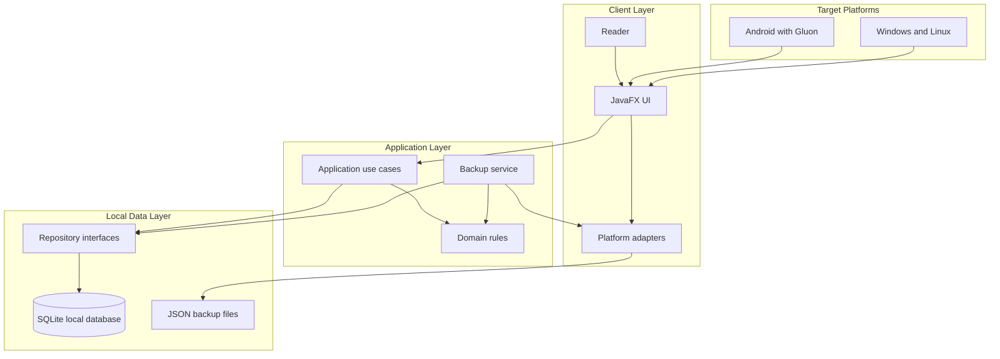
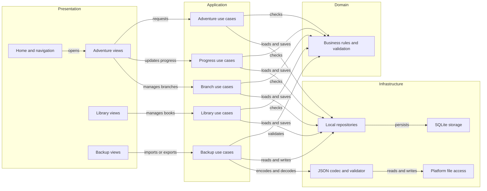

# Architecture Diagram

Ces diagrammes présentent l'architecture cible recommandée pour l'application, avant implementation. Ils ne décrivent pas du code existant. Le stockage SQLite et la faisabilité de JavaFX/Gluon sur Android restent à confirmer par un prototype.

## Application Architecture

<!-- mermaid-checked: no \n, no em-dash/en-dash, no {} in labels, subgraphs are id["label"], arrows are -->|"label"|, all subgraphs closed by end, ids unique -->

### Technology Stack Summary

| Layer | Technology | Version | Purpose |
|---|---|---|---|
| User interface | JavaFX | To validate | Shared desktop interface and Android UI toolkit |
| Android packaging | Gluon Mobile | To validate | Build and run the Java application on Android |
| Application logic | Java | Java 17 or compatible LTS | Use cases and business rules |
| Local persistence | SQLite | To validate | Offline storage on each device |
| Backup format | JSON | Versioned format to define | Manual export, import and transfer |
| Build tooling | Gradle and Android SDK | To validate | Android build and packaging; desktop tooling to confirm |

### Data Storage & External Services

The target application stores data locally in SQLite and uses JSON files for explicit backups. There are no application servers, accounts, cloud APIs or required network services in the MVP. A platform adapter handles local file selection and storage. Compatibility of the SQLite driver and file APIs with Gluon on Android must be tested before committing to the stack.

### Key Architectural Decisions

- Keep business rules independent from JavaFX and platform APIs so they can be tested without the UI.
- Use repository interfaces to isolate local persistence; the concrete SQLite integration may differ by platform.
- Treat import as a validated and confirmed operation; never replace local data silently.

## Component Relationships

The components below are proposed boundaries, not implemented classes. They exclude class and entity diagrams by design.

<!-- mermaid-checked: no \n, no em-dash/en-dash, no {} in labels, subgraphs are id["label"], arrows are -->|"label"|, all subgraphs closed by end, ids unique -->

### Component Inventory

| Component | Layer | Type | Responsibility |
|---|---|---|---|
| Home and navigation | Presentation | JavaFX views | Show recent adventures and navigate to main areas |
| Adventure views | Presentation | JavaFX views | Display adventure summary, team, history and branches |
| Library views | Presentation | JavaFX views | Browse base and personal books and edit book profiles |
| Backup views | Presentation | JavaFX views | Select a backup, review changes and confirm import or export |
| Adventure use cases | Application | Service boundary | Create, pause, resume and finish adventures |
| Progress use cases | Application | Service boundary | Record section progress and notes for the team |
| Branch use cases | Application | Service boundary | Create, switch and merge adventure branches |
| Library use cases | Application | Service boundary | Manage books, series and personal book profiles |
| Backup use cases | Application | Service boundary | Coordinate validation, conflict choices and atomic import/export |
| Business rules and validation | Domain | Rule boundary | Enforce consistency independently from UI and storage |
| Local repositories | Infrastructure | Persistence boundary | Load and save local data through platform storage |
| SQLite storage | Infrastructure | Local database | Persist application data offline |
| Platform file access | Infrastructure | Platform adapter | Select and write backup files on each target platform |
| JSON codec and validator | Infrastructure | Serialization boundary | Parse, validate and generate versioned backup files |
