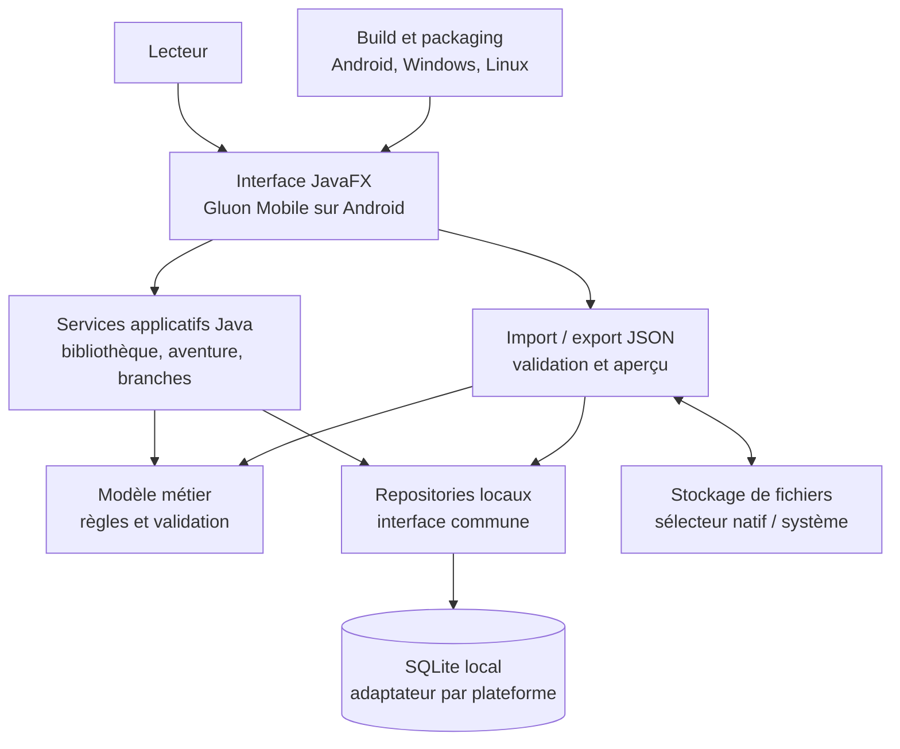
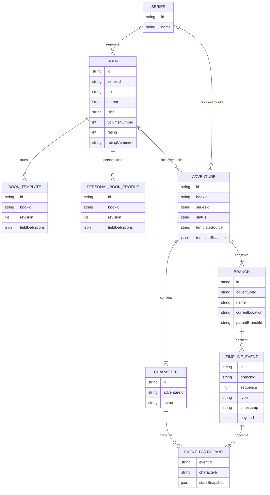

# Architecture et UX — Compagnon de LDVELH

## 1. Synthèse

Recommandation : réaliser une **application Java avec JavaFX et Gluon Mobile**, sans JavaScript. JavaFX fournit l’interface commune ; Gluon Mobile permet de construire une version Android, tandis que les versions Windows et Linux s’exécutent comme applications de bureau. Le domaine et les cas d’usage restent communs aux plateformes, avec des adaptations ciblées pour le stockage et les fichiers.

L’application est locale et autonome après son installation : les données de jeu sont stockées sur l’appareil. Aucun compte, serveur applicatif ou service cloud n’est requis au MVP. Les fichiers JSON assurent la sauvegarde et le transfert manuel. La distribution Android peut se faire par APK installé directement, sans publication sur le Play Store ; il faudra toutefois autoriser l’installation depuis cette source et gérer manuellement les mises à jour.

La priorité UX est de reprendre rapidement une partie, d’avancer la progression et de consulter ou modifier les personnages. L’interface reste sobre, utilisable d’une main sur téléphone et contenue au centre d’un grand écran.

Le présent document complète le [cadrage fonctionnel](./cadrage-fonctionnel-compagnon-ldvelh.md). Il distingue les décisions confirmées des recommandations et des points restant à valider.

## 2. Contexte et décisions

### Confirmé pendant l’entretien

- Application à créer, destinée d’abord à un usage personnel et familial (utilisateur, enfants de 14 et 17 ans, frère).
- Cibles : Android, Windows et Linux, avec les mêmes fonctions ; les données restent locales et indépendantes sur chaque appareil.
- Pas de synchronisation automatique au MVP. Le transfert manuel par fichier de sauvegarde suffit ; OneDrive ou Google Drive pourront servir ultérieurement à partager ces fichiers.
- Pas de publication Play Store souhaitée afin d’éviter les frais Google.
- Interface sobre et pratique, priorité à l’usage pendant la lecture ; utilisation possible d’une main ou téléphone posé sur une table.
- Sur ordinateur, pas d’interface étirée sur tout un écran ultralarge.
- À l’ouverture, afficher en priorité jusqu’à trois aventures en cours, puis un accès « Voir toutes » et une action visible pour commencer une nouvelle aventure. Bibliothèque et paramètres sont accessibles plus bas.
- En cours de partie, l’action principale est d’avancer et de suivre les données d’un personnage ou d’une équipe.
- En équipe, une vue agrégée présente des caractéristiques et équipements importants (à définir lors des spécifications) ; chaque fiche reste accessible individuellement.
- Modifications enregistrées automatiquement.
- Les champs d’un livre proviennent du modèle fourni ou personnalisé dans la bibliothèque. Le choix entre modèle de base et modèle personnalisé se fait à la création de chaque aventure.
- Le développeur connaît Java, XML, Maven et JavaFX, préfère VS Code et l’assistance IA, et ne souhaite pas utiliser JavaScript, TypeScript, React ou Angular.

### Recommandation de stack

- Java 17 ou version LTS compatible avec la version de Gluon retenue, JavaFX pour l’interface et Gluon Mobile pour le build Android.
- Gradle est vraisemblablement nécessaire pour les tâches mobiles et l’outillage Gluon ; Maven peut rester adapté au module métier ou au client desktop si la chaîne choisie le permet. VS Code peut être l’éditeur principal, mais ne remplace ni le JDK, ni le SDK Android, ni les outils de build mobile.
- Séparer le domaine Java des vues JavaFX et des adaptateurs de stockage/fichiers propres à chaque plateforme.
- Stockage local recommandé : SQLite derrière une interface de repository, avec une implémentation desktop et une implémentation Android si nécessaire. Valider très tôt la faisabilité du pilote SQLite avec Gluon ; le détail du pilote et du packaging est un risque technique à lever par un prototype.
- JSON versionné et validé à l’import ; le schéma de sauvegarde reste indépendant des détails de stockage local.
- Aucun service distant ou analytique dans le MVP.

### Points à confirmer en spécifications

- Versions Android minimales, appareils à tester et stratégie de distribution de l’APK hors Play Store.
- Compatibilité exacte de JavaFX/Gluon avec les versions de Java, Android SDK, Gradle et le pilote SQLite sélectionnés.
- Coûts, licences et conditions de distribution éventuels de la chaîne de build Gluon retenue.
- Packaging et signature des versions Android, Windows et Linux ; procédure de mise à jour manuelle.
- Champs personnalisés (types, listes, équipement, sorts), champs mis en avant dans le résumé d’équipe et règles de validation.
- Pour une aventure démarrée depuis une série, choix du tome de départ et du modèle de personnage applicable.
- Comportement exact d’une fusion de branches, notamment le devenir de la branche source et les événements postérieurs au point de divergence.
- Signification exacte de la progression pour une aventure portant sur une série : livre/tome sélectionné au démarrage, possibilité ou non de passer d’un tome à l’autre.
- Politique de conservation des sauvegardes et stratégie de récupération en cas de panne d’écriture ou de désinstallation.

## 3. Choix de plateforme

| Option | Avantages pour ce projet | Limites / décision |
|---|---|---|
| **JavaFX + Gluon Mobile (recommandée sous réserve d’un prototype)** | Reste en Java et JavaFX ; peut couvrir Android, Windows et Linux avec le domaine partagé ; fonctionnement hors ligne naturel ; JSON et accès aux fichiers intégrés à l’application ; distribution Android directe possible sans Play Store. | Chaîne mobile plus complexe que le desktop : SDK Android, Gradle et outillage Gluon à installer ; packages à produire/tester par plateforme ; installation APK et mises à jour à gérer manuellement. Compatibilité du stockage et des bibliothèques tierces à valider tôt. |
| Android natif en Java | Très bonne intégration Android et accès aux fonctions système. | Ne répond pas à la cible Windows/Linux sans développer et maintenir d’autres clients. SDK Android et Gradle nécessaires. |
| JavaFX desktop + client Android natif distinct | Expérience JavaFX familière sur ordinateur et intégration Android excellente. | Deux interfaces à maintenir et logique d’interface dupliquée ; option de repli si Gluon ne satisfait pas les exigences mobile. |
| .NET / Avalonia ou Flutter | Écosystèmes capables de couvrir plusieurs plateformes. | Impliquent d’apprendre respectivement C# ou Dart et ne correspondent pas à la préférence exprimée pour Java. |

**Compromis assumé :** JavaFX/Gluon permet d’éviter entièrement JavaScript et de réutiliser les connaissances existantes, au prix d’une chaîne Android moins simple qu’une application web. Il ne faut pas supposer que l’application JavaFX desktop fonctionne telle quelle sur Android : le packaging, certaines API système et le stockage devront être vérifiés sur un vrai appareil dès le prototype.

Les trois éditions n’exigent pas de connexion après installation. Les données ne sont pas partagées automatiquement entre plateformes. L’export JSON demeure essentiel, car la désinstallation ou la perte de l’appareil peut supprimer les données locales.

## 4. Architecture cible

### Diagramme de synthèse

Le diagramme représente les composants logiques, et non une topologie de serveurs : l’application et les données sont exécutées et conservées localement. Les adaptateurs de stockage et de sélection de fichiers peuvent varier selon la plateforme.



L’application ne fait pas d’appel réseau pour exécuter les fonctions du MVP. Les fichiers de sauvegarde sont lus et écrits sur l’appareil au moyen des API de fichiers disponibles sur chaque plateforme.

### Responsabilités des couches

1. **Interface** : navigation, formulaires, états de chargement/enregistrement, accessibilité et adaptation téléphone/ordinateur.
2. **Services applicatifs** : opérations explicites telles que démarrer une aventure, ajouter une étape, modifier un personnage, créer une branche, fusionner des branches et importer une sauvegarde.
3. **Domaine** : règles d’intégrité (progression d’équipe cohérente, branche complète, aventure et personnages liés, identifiants stables), indépendantes de JavaFX et des API de plateforme.
4. **Repositories** : accès transactionnel à la base locale, index et migrations de schéma ; l’interface Java est partagée, l’implémentation du pilote peut être spécifique à Android et au desktop.
5. **Import/export** : format JSON public, versionné et validé, aperçu des modifications et application atomique après confirmation.
6. **Adaptateurs plateforme** : accès aux fichiers, au stockage et aux fonctions système nécessaires, sans introduire de logique métier spécifique à l’interface.

### Organisation de code proposée

```text
src/main/java/
  .../app/              # démarrage et navigation JavaFX
  .../domain/           # entités, validation et règles métier
  .../application/      # cas d’usage et services applicatifs
  .../features/         # vues bibliothèque, aventures, personnages, branches
  .../storage/          # repositories, migrations et abstraction SQLite
  .../backup/           # import/export JSON et résolution des conflits
  .../platform/         # adaptations de fichiers et de stockage
src/main/resources/     # FXML/CSS, icônes, modèles préchargés
```

Garder les services de domaine indépendants de JavaFX et du pilote SQLite permet de tester les opérations sensibles (branches, progression, import) sans interface ni appareil mobile.

## 5. Modèle de données proposé

Les identifiants sont générés une fois (UUID), conservés à l’export et utilisés pour faire correspondre les objets à l’import. Les noms ne sont jamais des identifiants : deux livres ou personnages homonymes restent distincts.

### Entités et relations

Le diagramme est un modèle conceptuel. Il n’impose pas la représentation physique exacte dans SQLite.



### Règles de modèle

- Un livre correspond à une fiche distincte, y compris chaque tome d’une série.
- Une aventure cible un livre ou une série, mais pas les deux simultanément. La contrainte est vérifiée par le domaine.
- Un modèle de base peut être fourni pour un livre préchargé ; le profil personnel conserve la personnalisation de l’utilisateur sans modifier ce catalogue.
- Une aventure conserve un instantané des définitions de champs choisies à sa création (modèle de base ou profil personnalisé). Les changements ultérieurs à la bibliothèque ne modifient donc pas silencieusement les aventures existantes.
- Les caractéristiques définies par le livre sont des valeurs de référence en lecture seule pour l’instance de personnage. L’équipement, lui, est modifiable par aventure et par branche. Les autres champs éditables restent à spécifier.
- Une progression d’équipe est une opération unique, enregistrée transactionnellement pour tous les personnages concernés. Les vues d’historique par personnage sont dérivées des participants de chaque événement.
- Le journal d’une branche doit représenter les événements de progression **et** les modifications de données de jeu nécessaires à la reconstitution de l’état à un point historique. Un état courant par branche accélère l’affichage ; les événements/snapshots permettent de créer une branche à partir d’un ancien point sans reprendre les valeurs actuelles par erreur.
- Une branche référence le parcours entier de l’équipe. Les personnages sont identités d’aventure ; leurs états courants et événements sont propres à la branche.
- Une branche créée depuis un point historique reçoit le préfixe et l’état correspondant à ce point ; la branche d’origine reste intacte. La façon de partager physiquement le préfixe ou de le copier est un détail d’implémentation, tant que les deux historiques deviennent indépendants.
- Recommandation pour la fusion : garder la branche explicitement choisie comme source inchangée et supprimer la branche de destination, sans fusionner leurs événements ni créer de branche. Confirmer en affichant le nom de destination et la perte de son contenu ; exécuter la suppression et la mise à jour éventuelle de la branche active dans une seule transaction. Ce point doit être confirmé, car le cadrage le laisse ouvert.

## 6. Parcours UX

### Navigation globale

- Proposition à valider : barre basse sur téléphone avec **Accueil**, **Aventures**, **Bibliothèque** et **Plus** (sauvegardes et paramètres). Sur ordinateur, reprendre les mêmes entrées dans une barre supérieure.
- L’utilisateur n’a pas encore de préférence sur le type de navigation mobile ; la barre basse est une recommandation UX, pas une décision confirmée.
- L’ouverture d’une aventure mène à son **résumé**, et non directement à une fiche ou à l’historique.

### Inventaire des écrans et comportements

#### Accueil

- Montrer les trois aventures en cours les plus récemment utilisées, avec nom de l’aventure, livre, branche active et section actuelle.
- « Voir toutes » ouvre la liste complète ; « Nouvelle aventure » reste une action principale visible même lorsqu’il existe des parties en cours.
- Bibliothèque, sauvegardes et paramètres sont accessibles depuis l’accueil, en dessous des actions de jeu.
- État vide : expliquer comment commencer, avec accès immédiat à « Nouvelle aventure » et à la bibliothèque.

#### Liste des aventures

- Séparer les aventures **En cours**, **En pause** et **Terminées**.
- Une carte ouvre le résumé de l’aventure.
- Détails de recherche, filtres et tri autres que la récence à définir seulement si le volume d’usage le justifie.

#### Résumé d’une aventure

- Afficher le titre, le livre, la branche active et la section courante.
- Permettre de saisir directement le numéro de section : les sections ne sont pas nécessairement consécutives, donc ne pas proposer de contrôle principal « + / − ».
- Permettre d’ajouter directement une section depuis le résumé avec le champ « Nouvelle section » et le bouton « Ajouter ».
- La note est optionnelle et repliable. Une seule entrée est créée par ajout valide, affichée en tête du fil récent (historique récent), puis le champ est vidé.
- Un champ vide ou invalide affiche un message d’erreur court et ne crée aucune entrée.
- La saisie complète reste accessible via le lien secondaire discret « Ajouter une note détaillée » vers l’écran de saisie complet.
- Afficher un résumé de l’équipe en lecture seule : caractéristiques et certains éléments d’équipement, sélectionnés lors des spécifications détaillées. Ouvrir chaque fiche pour modifier les champs autorisés.
- Donner un accès rapide à l’historique et aux branches. Le menu d’actions contient « Mettre en pause » et « Terminer l’aventure ».

#### Fiche d’un personnage

- Regrouper les informations en sections visibles les unes sous les autres, toutes ouvertes par défaut ; ordre fixe, sans réorganisation des champs au MVP.
- Les caractéristiques définies par le livre sont consultables, mais non modifiables pendant la partie.
- L’équipement est modifiable. Caractéristiques, argent, notes et sorts sont présentés selon le modèle du livre ; les droits de modification de l’argent, des notes et des sorts restent à confirmer dans les spécifications métier.
- Enregistrer automatiquement les champs modifiés et indiquer l’état d’enregistrement. Les changements sont rattachés à la branche active afin qu’une branche alternative garde son état propre.
- Chaque personnage de partie est une instance propre à l’aventure ; modifier son équipement ne modifie jamais le modèle vierge du livre ni les personnages des autres aventures.

#### Historique

- Afficher les étapes de la plus récente à la plus ancienne, avec section, tome si applicable, date et note.
- Choisir une ancienne étape pour reprendre ouvre immédiatement une proposition de création de branche, sans altérer la branche d’origine.
- Proposer un nom modifiable dérivé du nom de l’aventure et d’un suffixe indexé, par exemple `Mon aventure_2`, en choisissant un index disponible.
- La nouvelle branche reprend l’état des personnages (caractéristiques et équipement) à cette étape, devient immédiatement la branche active et s’ouvre sur son résumé.

#### Gestion des branches

- Donner un accès rapide à la liste des branches depuis le résumé et un écran dédié pour les consulter et les gérer.
- Changer de branche bascule immédiatement vers celle-ci et son état courant ; éviter une étape de prévisualisation obligatoire.
- Afficher clairement la branche active dans le résumé.
- Les actions de fusion doivent être présentées avec leurs conséquences et confirmées ; la sémantique précise de la branche source reste à valider (voir section 5).

#### Création d’une aventure

- Utiliser un formulaire unique, ordonné pour commencer par le livre, puis les personnages et les paramètres de départ.
- Séparer visuellement **Livres de base** et **Livres personnels**. Si un livre de base est personnalisé, l’original reste dans la liste de base et la version modifiée apparaît comme une fiche personnelle distincte.
- Permettre de choisir un livre existant ou de créer un livre personnel dans le parcours de création ; au retour, conserver les informations déjà saisies dans le formulaire d’aventure.
- Le livre définit sa feuille d’aventure : modèles de personnages disponibles, caractéristiques et section de départ proposée.
- Après le choix du livre, présenter la liste de ses modèles/personnages ; le lecteur choisit un ou plusieurs personnages à instancier dans cette aventure. Une nouvelle aventure repart ainsi de personnages vierges du modèle.
- Proposer un nom d’aventure basé sur le livre, modifiable avant création.
- Proposer la section initiale définie par le livre, tout en la laissant modifiable pour cette aventure.
- Les détails de sélection d’un modèle de champs de base ou personnel doivent suivre la version de livre choisie, sans appliquer les changements futurs aux aventures déjà créées.

#### Bibliothèque

- Présenter les livres de base et les livres personnels comme deux listes distinctes.
- La personnalisation d’un livre de base crée une fiche personnelle dérivée ; elle ne modifie pas le livre de base.
- La fiche de livre gère les métadonnées déjà prévues au cadrage et la feuille d’aventure : section de départ, modèles de personnages, caractéristiques définies par le livre et équipements initiaux.
- L’édition détaillée des modèles (ajout/suppression de modèles de personnage, types de champ, contraintes des caractéristiques) reste à définir avant conception des données.

#### Sauvegarde et paramètres

- Conserver les parcours JSON détaillés en section 7.
- Regrouper import/export dans un écran accessible depuis « Plus » et l’accueil.
- Présenter les préférences d’affichage et les informations sur les données locales dans les paramètres ; aucun compte ni synchronisation au MVP.

### Parcours d’interaction principaux

**Reprendre une aventure**
1. Accueil → choisir une carte d’aventure → résumé.
2. Vérifier branche active et section ; saisir le numéro dans « Nouvelle section », ouvrir éventuellement la note, puis sélectionner « Ajouter ».
3. Si l’ajout est valide, une entrée est créée en tête du fil récent et le champ est vidé ; pour une note détaillée, suivre le lien « Ajouter une note détaillée » vers l’écran de saisie complet.

**Créer une partie**
1. Accueil → « Nouvelle aventure ».
2. Sélectionner un livre dans Livres de base ou Livres personnels.
3. Examiner les personnages/modèles fournis par ce livre et sélectionner l’équipe.
4. Modifier le nom proposé et, si nécessaire, la section de départ proposée.
5. Créer l’aventure avec des instances de personnages vierges ; arriver sur le résumé de sa branche initiale.

**Repartir d’un ancien point**
1. Résumé → Historique → sélectionner une étape passée.
2. Modifier le nom de branche proposé et confirmer la création.
3. L’application restaure l’état de l’équipe à cette étape, conserve la branche d’origine et active la nouvelle branche.

**Modifier l’équipement**
1. Résumé → ouvrir la fiche du personnage.
2. Modifier l’équipement ; les caractéristiques du livre restent en lecture seule.
3. L’enregistrement automatique s’applique à la branche active.

### Maquettes textuelles

**Accueil mobile**

```text
┌──────────────────────────┐
│ Compagnon                │
│ Reprendre                │
│ ┌──────────────────────┐ │
│ │ Aventure — Livre A   │ │
│ │ Branche 1 · sect. 42 │ │
│ └──────────────────────┘ │
│ ┌──────────────────────┐ │
│ │ Aventure — Livre B   │ │
│ │ Branche 1 · sect. 18 │ │
│ └──────────────────────┘ │
│        Voir toutes       │
│     [+ Nouvelle partie]  │
│ Bibliothèque             │
│                          │
│ Accueil Aventures Livres │
│             Plus         │
└──────────────────────────┘
```

**Résumé d’aventure**

```text
┌──────────────────────────┐
│ ← Aventures        Menu ⋮│
│ Mon aventure · Livre A   │
│ Branche : Mon aventure_2 │
│ Section actuelle         │
│ Nouvelle section         │
│ [          42          ] │
│ [Ajouter]                │
│ Note (facultative) ▸     │
│ [Ajouter une note        │
│  détaillée]              │
│                          │
│ [message d’erreur court] │
│ Fil récent               │
│ 42 · note éventuelle     │
│ Équipe                   │
│ Héros 1 · carac… · objet │
│ [Ouvrir la fiche]        │
│ Héros 2 · carac… · objet │
│ [Ouvrir la fiche]        │
│ Historique · Branches    │
└──────────────────────────┘
```

**Fiche personnage**

```text
┌──────────────────────────┐
│ ← Résumé · Héros 1       │
│ Caractéristiques         │
│ Force       12 (lecture) │
│ Habileté     8 (lecture) │
│ Équipement              │
│ [Épée                 ]  │
│ [+ Ajouter un objet]     │
│ Argent                   │
│ Notes                    │
│ ... sections ouvertes ...│
│ Enregistré               │
└──────────────────────────┘
```

Sur ordinateur, garder une zone de contenu centrée (largeur maximale approximative de 1100 px), avec barre de navigation supérieure et éventuellement deux panneaux côte à côte lorsque cela facilite la lecture. Ne pas étirer formulaires et textes sur tout l’écran ultralarge.

### Principes UX et accessibilité

- Actions fréquentes proches du bas de l’écran sur téléphone ; cibles tactiles d’environ 44 × 44 px ou davantage.
- Afficher un état d’enregistrement discret (« Enregistré » / « Enregistrement… ») et ne jamais annoncer « enregistré » avant la confirmation de l’écriture locale.
- Enregistrer au changement de focus ; lors de la saisie d’un champ long, éviter une écriture coûteuse à chaque frappe tout en vidant les changements en attente lors de la navigation ou de la fermeture de l’application.
- Contraste lisible, taille de texte adaptable, focus clavier visible, labels explicites, navigation clavier sur ordinateur et annonces compatibles avec les lecteurs d’écran.
- Ne pas communiquer une erreur uniquement par la couleur ou une icône. Préserver les données saisies en cas d’erreur de validation ou d’écriture.
- Confirmer les opérations destructrices (suppression et fusion) en décrivant précisément leur effet et les éléments concernés.
- Prévoir les états vide, chargement local, erreur de stockage, sauvegarde invalide et conflit d’import ; proposer une action de récupération claire.

## 7. Sauvegardes, import et intégrité

### Format d’export

Le fichier JSON contient une enveloppe stable et versionnée, par exemple :

```json
{
  "format": "ldvelh-companion-backup",
  "schemaVersion": 1,
  "exportedAt": "2026-01-01T12:00:00.000Z",
  "data": {
    "series": [],
    "books": [],
    "personalBookProfiles": [],
    "adventures": [],
    "characters": [],
    "branches": [],
    "events": []
  }
}
```

La date est indicative ; les identifiants stables déterminent les correspondances. Le format doit documenter les champs obligatoires et tolérer les champs optionnels inconnus lorsque la compatibilité le permet. Les migrations de format sont distinctes des migrations de la base locale.

### Import recommandé

1. Lire le fichier choisi sans remplacer les données existantes.
2. Vérifier taille raisonnable, encodage, structure, version, types et contraintes relationnelles ; ne jamais exécuter de contenu du JSON.
3. Présenter un résumé des ajouts, mises à jour, éléments sans conflit et conflits.
4. Comparer les valeurs en conflit champ par champ, avec choix explicite ; afficher les différences de collections de manière intelligible.
5. Appliquer tous les choix dans une transaction atomique, après confirmation. En cas d’échec, conserver l’état précédent et signaler clairement l’erreur.
6. Proposer un export préalable de l’état local avant une opération de remplacement ou une grande mise à jour.

Le traitement de conflits de valeurs ne doit pas fusionner implicitement les parcours de branches : une branche reste un ensemble cohérent. Les objets référencés doivent être importés ou résolus avant leurs enfants.

### Sauvegarde et partage

- Rendre « Exporter une sauvegarde » facile à trouver et rappeler que les données appartiennent à l’appareil.
- Générer un nom de fichier informatif avec date, sans inclure de données de personnage dans le nom.
- À l’import, ouvrir le sélecteur de fichiers natif de la plateforme ; l’utilisateur peut choisir un fichier local ou un emplacement cloud si le système l’expose.
- OneDrive/Google Drive peuvent héberger un fichier choisi par l’utilisateur, sans intégration API au MVP. Éviter les modifications simultanées du même fichier sur plusieurs appareils : il n’y a pas de synchronisation ni de verrouillage concurrent.

## 8. Sécurité, confidentialité et exploitation

- Les données sont non sensibles selon le besoin exprimé ; aucun chiffrement par mot de passe n’est requis.
- Aucun compte, serveur de données, publicité ou télémétrie n’est nécessaire au MVP. Demander seulement les permissions système requises et expliquer leur utilité.
- Les données restent dans l’espace privé de l’application sur chaque appareil et ne sont pas partagées entre appareils.
- Traiter les noms, notes et champs importés comme des données, jamais comme du code ou du balisage exécutable.
- La validation des fichiers doit être stricte et explicite. Un fichier invalide ne doit jamais aboutir à un succès partiel silencieux.
- Les sauvegardes peuvent contenir toutes les notes et données de jeu : l’interface doit indiquer que l’utilisateur contrôle le fichier exporté et son partage.
- Distribuer les exécutables via des canaux adaptés à chaque plateforme. L’APK direct évite le Play Store, mais sa signature, sa provenance et les mises à jour manuelles doivent être documentées.
- Une mise à jour de l’application ne doit jamais effacer ou convertir les données sans migration validée.
- Prévoir migrations de schéma testées, sauvegarde de précaution avant migration destructive et message explicite si le stockage local est indisponible.

## 9. Qualité et validation

La validation devra couvrir les comportements réels, et pas seulement le rendu de l’interface :

- **Domaine** : progression d’équipe atomique, historique individuel, création de branche avec état historique correct, conservation de la branche source, sémantique de fusion confirmée.
- **Persistance** : fermeture/réouverture, changement de version de schéma, erreurs SQLite et états d’enregistrement sur chaque plateforme.
- **Sauvegarde** : aller-retour export/import de toutes les entités, fichier malformé, version inconnue, doublons, homonymes, conflits champ par champ, annulation et échec transactionnel.
- **Hors ligne** : installation de chaque build puis lancement et opérations complètes sans réseau ; mise à jour sans perte des données.
- **Responsive et accessibilité** : téléphone Android, clavier et lecteur d’écran, écran de bureau borné et test de largeur ultralarge.
- **Compatibilité plateforme** : vérifier build, installation, retour après fermeture, sélection de fichiers et SQLite sur Android, Windows et Linux.

Un petit jeu de données préchargé ne doit pas être confondu avec les données personnelles : séparer clairement le catalogue intégré, les ajouts de l’utilisateur et leurs personnalisations afin qu’une mise à jour du catalogue ne remplace rien silencieusement.

## 10. Décisions différées

1. Confirmer la navigation mobile (barre basse recommandée), puis définir les champs du résumé d’équipe et les sections/éléments éditables des fiches de personnage.
2. Confirmer les règles de création et de fusion des branches ; en particulier, valider la recommandation de conserver la source et de supprimer seulement la destination.
3. Réaliser un prototype technique JavaFX/Gluon sur un appareil Android réel : affichage, build, stockage local et sélection de fichier JSON.
4. Vérifier les coûts, licences et conditions de distribution de la chaîne de build Gluon retenue.
5. Établir les versions de Java, Gluon, Android SDK et les cibles Windows/Linux ; produire et tester les packages de chaque plateforme.
6. Définir le traitement des valeurs par défaut du catalogue lors d’une mise à jour et la politique de migration du JSON.
7. Si le prototype Gluon échoue sur une exigence bloquante, comparer JavaFX desktop avec un client Android natif Java séparé avant de changer de langage ou d’ajouter une stack web.
8. À préciser : la portée d’une entrée (équipe ou personnage) et la possibilité d’ajouter une section sur une aventure terminée.
