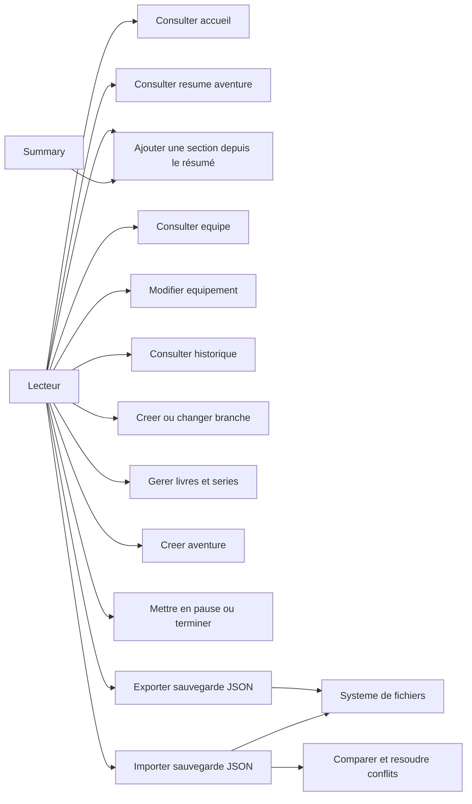
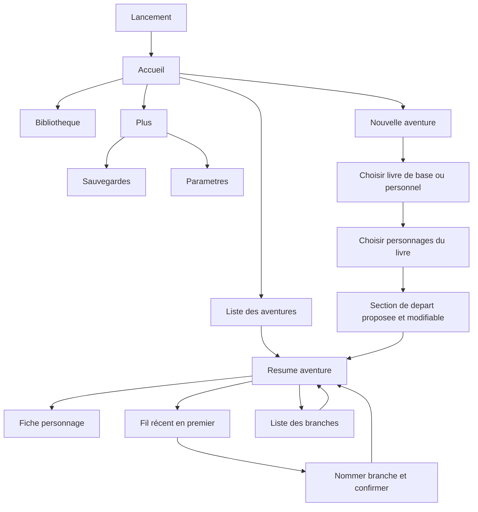
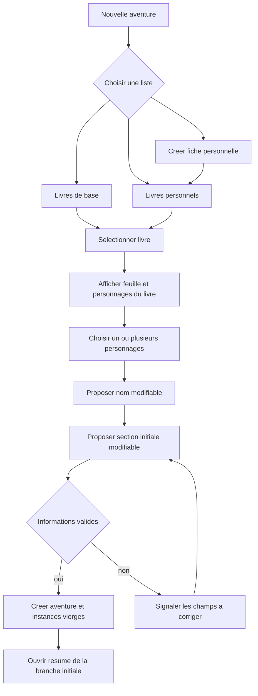

# Cas d'utilisation et navigation — Compagnon LDVELH

## Statut du document

Ces diagrammes décrivent les parcours cibles issus du cadrage et des décisions UX. L'application n'étant pas encore implémentée, ils sont des spécifications et non une description du comportement actuel. Les cas d'utilisation, la navigation et le parcours d'activité en flowchart sont des approximations Mermaid, pas des notations UML natives. Aucun diagramme de classes ou d'entités n'est inclus.

## Acteurs et cas d'utilisation

Le lecteur est le seul acteur métier prévu pour le MVP. Les opérations de fichiers utilisent le système d'exploitation comme acteur secondaire.

## Navigation mobile proposée

La barre basse est une recommandation à confirmer. La sélection d'une aventure ouvre son résumé ; l'ajout d'une section depuis le résumé est l'action principale, avec note facultative repliable et fil récent ; les écrans d'historique, de branches et de fiches sont accessibles depuis celui-ci. La saisie complète est un accès secondaire via « Ajouter une note détaillée ».

## Parcours de création d'aventure

Un formulaire unique suit l'ordre du choix du livre, de l'équipe et des valeurs initiales. Les personnages créés sont des instances propres à la nouvelle aventure.

