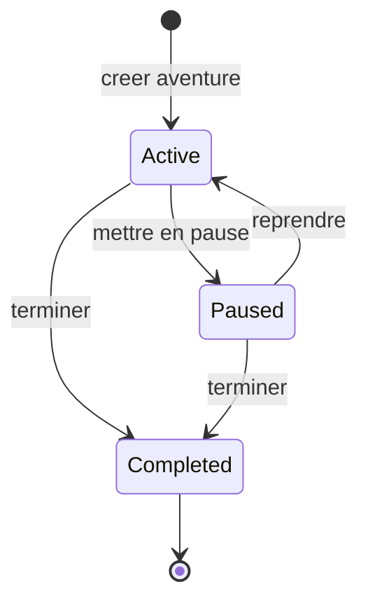
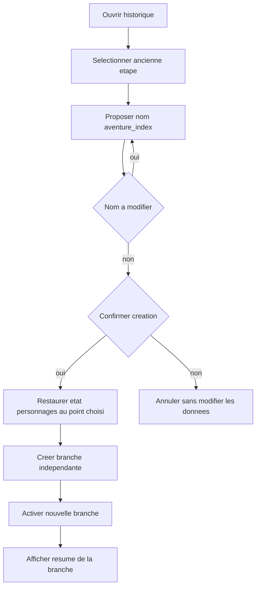
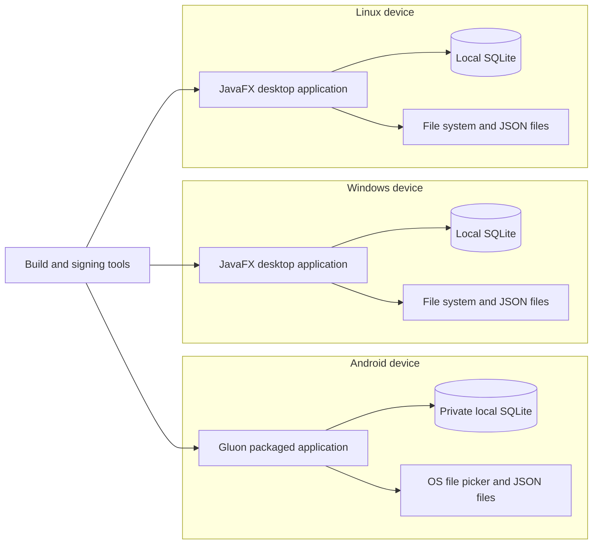

# Cycle de vie et déploiement — Compagnon LDVELH

## Statut du document

Ces vues décrivent les états et environnements cibles du MVP. JavaFX/Gluon, le packaging et SQLite restent à valider par prototype. Le diagramme d'état utilise la syntaxe Mermaid dédiée ; les vues d'activité et de déploiement sont des approximations en flowchart, pas une notation UML native. Ce document n'inclut ni diagramme de classes ni diagramme d'entités.

## Cycle de vie d'une aventure

Une aventure terminée reste consultable. Le cadrage ne prévoit pas de transition de retour depuis l'état terminé ; le diagramme la traite donc comme terminale, sous réserve de confirmation des règles métier.

La branche active est un état du parcours de l'aventure, indépendant du statut actif/en pause/terminé : changer de branche ne réactive pas une aventure terminée.

## Activité : reprendre depuis un point passé

## Déploiement logique cible

Ce diagramme montre les paquets applicatifs et leurs données locales, sans infrastructure serveur. Les builds Android, Windows et Linux sont distincts ; les données ne sont pas automatiquement partagées entre eux.

Le fichier JSON constitue le mécanisme manuel de transfert entre appareils. Tout partage via OneDrive ou Google Drive est réalisé par le lecteur au moyen du système de fichiers ; aucune synchronisation applicative n'est prévue au MVP.
