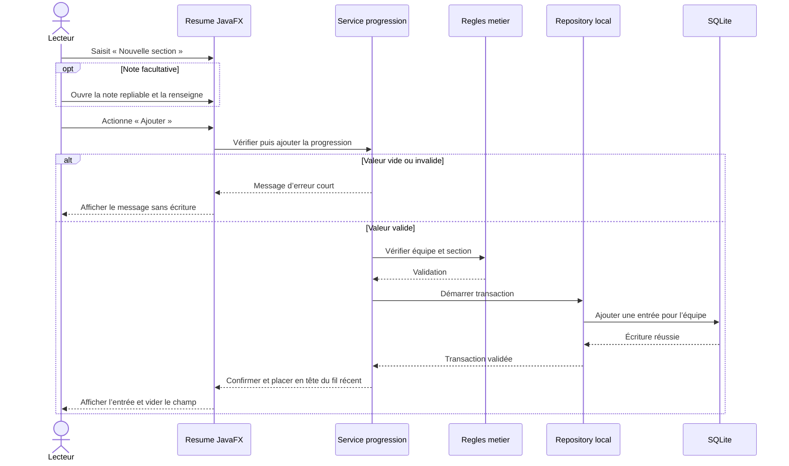
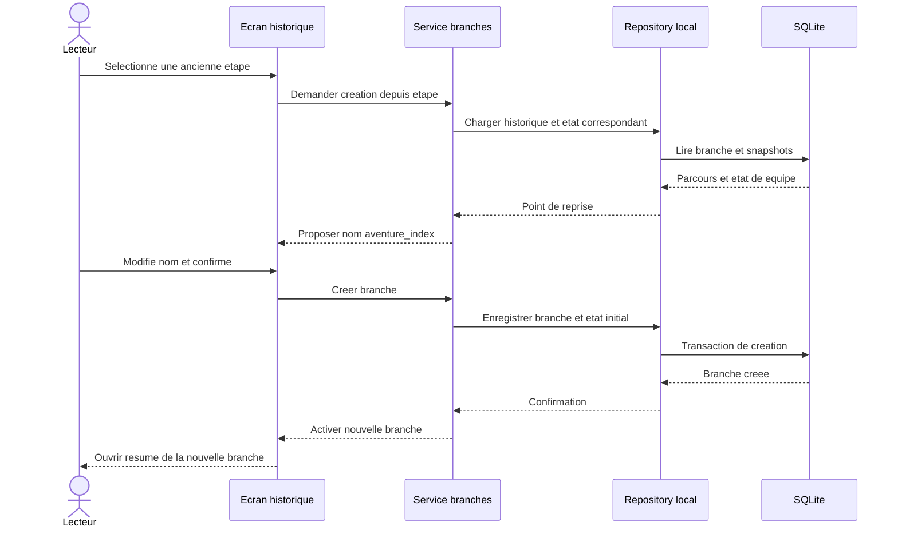
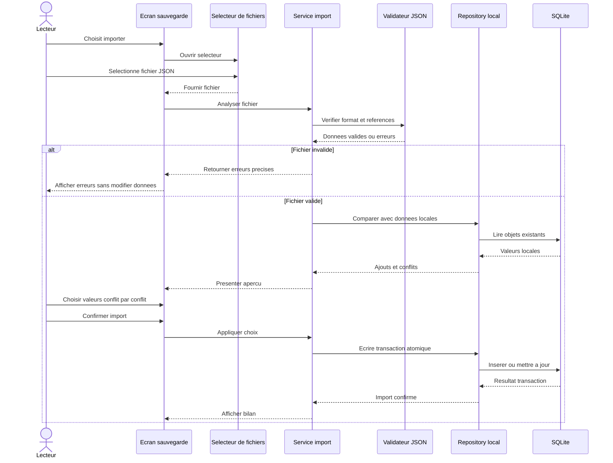
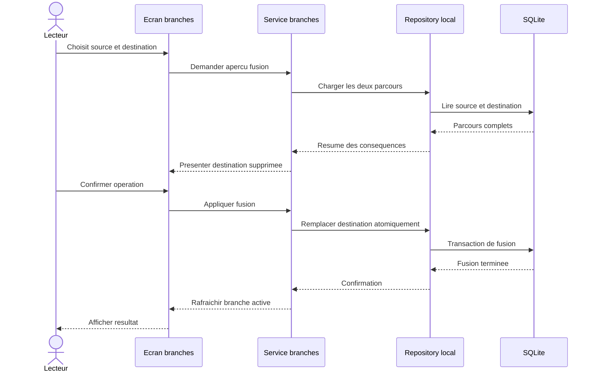

# Interactions — Compagnon LDVELH

## Statut du document

Les séquences décrivent les interactions prévues entre le lecteur, l'interface JavaFX/Gluon, les services applicatifs et le stockage local. Ce sont des spécifications de l'architecture cible ; aucun code n'est encore disponible pour les confirmer. Les classes et entités métier ne sont pas détaillées ici.

## Enregistrer la progression d'une équipe

L’action « Ajouter » crée une seule étape cohérente pour tous les personnages de l’équipe. La note est facultative et repliable ; la saisie complète est accessible via « Ajouter une note détaillée ».

En cas d'échec de validation ou d'écriture, l'interface conserve la saisie, affiche un message d'erreur court et ne présente pas l'étape comme enregistrée. À préciser : la portée de l'entrée (équipe ou personnage) et l'ajout sur une aventure terminée.

## Créer une branche depuis l'historique

L'annulation avant confirmation ne modifie ni la branche source ni l'historique existant.

## Importer une sauvegarde JSON

Si le lecteur annule l'aperçu, aucune donnée locale n'est modifiée. Une erreur transactionnelle laisse l'état antérieur intact et doit être signalée.

## Fusionner deux branches

La politique de fusion doit encore être confirmée. La séquence représente la recommandation actuelle : conserver intégralement la branche choisie et remplacer/supprimer la destination sans mélange champ par champ ni création d'une branche supplémentaire.

